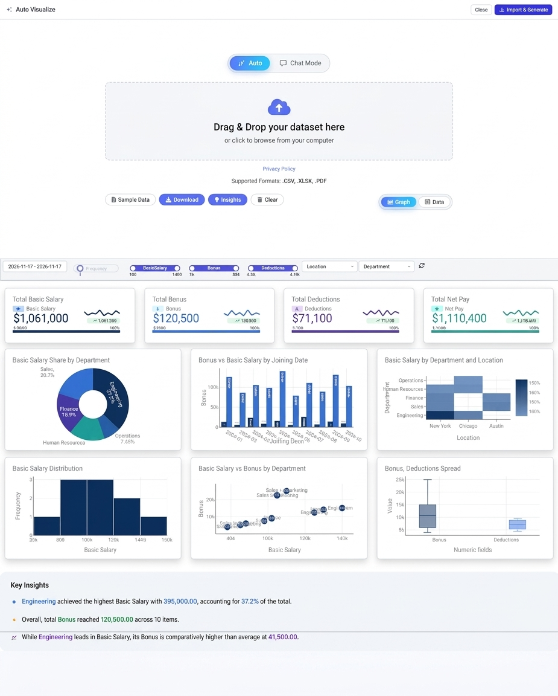

# AI Chart Generator: Turn a Spreadsheet, CSV or PDF Table Into Charts in Minutes

*Upload your data, type what you want to see in plain English, and get a chart or a full dashboard. No sign-up required to generate and download.*

**Try it free:** [AI Chart & Dashboard Generator by Dashboard Builder](https://dashboardbuilder.net/ai-dashboard-generator)

---

## The problem: your data is ready, but your chart is not

You have the numbers. They sit in an Excel sheet, a CSV export or a PDF report someone emailed you. What you do not have is a chart, and the meeting is tomorrow.

Most people hit the same walls:

### 1. "My data is trapped in a PDF"

Invoices, scanned reports and emailed statements often arrive as PDFs. You cannot chart a PDF. Retyping the table into Excel is slow and full of mistakes.

**How the AI chart generator helps:** it reads **PDF files that contain a table**, extracts the table, and then builds the chart. You do not retype anything. It works the same way for **CSV** and **Excel (.xlsx)** files.

### 2. "I don't know which chart to use"

A bar, line, pie or scatter chart can all draw your data, but only one tells the right story. Choose badly and the point is lost.

**How it helps:** the AI reads your column headers and maps them to axes, then picks the chart type, colors, labels and layout that fit the shape of your data. You can override any choice.

### 3. "I can't (or don't want to) write formulas, queries or chart code"

You know the question: "show monthly revenue by region". Turning that into pivot tables, formulas or SQL is the slow part.

**How it helps:** use **Chat mode**. Type what you want in plain English and get one chart back. See example prompts below.

### 4. "Building a whole dashboard by hand takes forever"

Picking KPIs, laying out six charts and writing a summary takes hours in a spreadsheet.

**How it helps:** use **Auto mode**. It builds a dashboard with **4 KPI cards, 6 charts and a Key Insights panel** from your file.

### 5. "My data is messy"

Merged cells, inconsistent date formats and a stray totals row quietly ruin charts.

**How it helps:** the AI flags likely data issues such as merged cells, inconsistent date formats and stray totals rows, so you can fix the source before you trust the chart.

### 6. "I need the chart in my own website or app, not just a picture"

A screenshot goes out of date and looks out of place.

**How it helps:** download the result as **PNG, PDF, HTML, PHP, Laravel, a WordPress plugin or a Joomla plugin**. Add it to a full Dashboard Builder dashboard to use a live, refreshing data source instead of a one-time upload.

---

## How it works in 4 steps

1. **Upload your data.** Drag in a file or click to browse. Supported files: **CSV (.csv), Excel (.xlsx) and PDF (.pdf) with a table.**
2. **Choose a mode.**
   - **Auto mode:** a full dashboard with 4 KPI cards, 6 charts and Key Insights.
   - **Chat mode:** one chart from a plain-English prompt.
3. **Customize.** Change the palette, axis labels, title and legend, or apply a saved color theme.
4. **Download.** PNG, PDF, HTML, PHP, Laravel, WordPress plugin or Joomla plugin.

> You need to upload a file first. The AI cannot create a chart from typing alone.

---

## AI chat prompts: tell it what you want to see

In Chat mode you write the chart you want, and the AI builds it from your uploaded data. Prompts that work well name the **chart type**, the **measure** and the **grouping**:

| Prompt | What you get |
|---|---|
| `Generate a pie chart to show age and income` | A part-to-whole pie chart |
| `Show monthly revenue by region as a bar chart` | Revenue per region, by month, as bars |
| `Plot sales over time as a line chart` | A trend line |
| `Compare salary and bonus by department` | A category comparison |

Tips for better prompts:
- **Name the chart type** if you care about it ("as a bar chart").
- **Name your columns** the way they appear in your file.
- **Ask for one thing at a time.** Chat mode creates one chart per prompt, so run several prompts for several charts.
- **Click a suggested prompt** if you are not sure what to ask.

Not sure whether to use Auto or Chat? Use **Auto** to get a full first dashboard, then use **Chat** to add or replace individual charts.

---

## Key Insights: a summary, not just charts

Auto mode adds a **Key Insights** panel that states what the data says in words. For a payroll file, for example, it can point out which department has the highest basic salary and its share of the total, and which department's bonus is above average. That gives you a sentence for your report, not just a picture.

---

## Which chart for which question

| You want to show | Use |
|---|---|
| A trend over time | Line chart |
| Comparison between categories | Bar chart (better than pie beyond 3 to 4 categories) |
| Parts of a whole (5 or fewer segments) | Pie or donut |
| A relationship between two variables | Scatter chart |
| Composition over time | Stacked area or bar |
| A distribution | Histogram |

Auto mode chooses between line, bar, pie and scatter based on the shape of your data.

**Chart mistakes to avoid** if you override the AI's defaults: truncated y-axes, too many colors, pies with too many slices, 3D effects, missing data labels, and palettes that are not colorblind-safe.

---

## Free, with no account needed to generate

- Generate, customize and download **without signing up**.
- **No watermark and no locked export tier** on the free generator.
- Uploaded files are used to build your chart and do not need to be linked to an account.
- **Sign up for the control panel** if you want to save and edit dashboards later.

Paid Dashboard Builder plans are for teams that want to save dashboards to a shared control panel, schedule live data refreshes, or apply branding across many charts. See the [pricing page](https://dashboardbuilder.net/dashboard-builder-pricing).

---

## From one-off charts to live dashboards

The generator works from the file you upload. When you want charts that update by themselves, move them into a full Dashboard Builder dashboard, which connects to live sources such as MySQL, PostgreSQL, Oracle, ODBC, JSON and REST APIs, Google Sheets, and Excel, CSV and PDF files.

Dashboard Builder comes in several editions:
- **Cloud edition**: build in your browser.
- **Self-hosted edition**: run it on your own PHP server so your data stays with you. [Download the free edition](https://dashboardbuilder.net/download-free-dashboard).
- **Windows desktop app**: build dashboards on your own PC. [See the desktop version](https://dashboardbuilder.net/download-desktop-dashboardbuilder).

---

## What it is not for

- It is for **data charts**, not process flowcharts or diagrams.
- Auto mode produces a fixed layout of 4 KPI cards and 6 charts.
- Always check the result against your source, especially before you share it. Verify totals, filters and axes.

---

## Get started

1. Open the [AI Chart & Dashboard Generator](https://dashboardbuilder.net/ai-dashboard-generator).
2. Upload a CSV, Excel or PDF table.
3. Pick **Auto mode** for a full dashboard or **Chat mode** and type a prompt.
4. Download it as an image, PDF, HTML or code, and put it on your site.

---

## FAQ

**Do I need an account?**
No. You can generate and download without signing up. You need to sign up only to save and edit dashboards later.

**Can it read a PDF?**
Yes. It extracts tables from PDF files and then charts them, as well as reading CSV and Excel files.

**What is the difference between Auto mode and Chat mode?**
Auto mode builds a full dashboard (4 KPI cards, 6 charts and Key Insights). Chat mode creates one chart from a plain-English prompt.

**Can I create a chart just by typing?**
No. Upload a file first. The AI charts your data, it does not invent it.

**What can I download?**
PNG, PDF, HTML, PHP, Laravel, WordPress plugin and Joomla plugin.

**Does it add a watermark?**
Not on the free generator.

**Can I turn a chart into a live dashboard?**
Yes. Add it to a Dashboard Builder dashboard and connect a live data source.

**Can it make flowcharts?**
No. It is built for data charts.

---

*Dashboard Builder is made by Diginix Technologies Inc. Learn more at [dashboardbuilder.net](https://dashboardbuilder.net) and try the [AI Chart & Dashboard Generator](https://dashboardbuilder.net/ai-dashboard-generator).*
